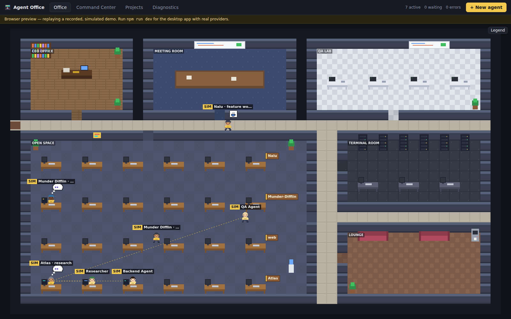

# Agent Office

**Agent Office** is a native desktop app for Windows 11 and macOS that shows the AI
coding agents you have running — Claude Code, OpenAI Codex CLI and Cursor CLI — as characters in a
living pixel-art office. Each session is an employee: you can see who is coding, who
is running tests, who is waiting for your permission and who just hit an error, and
you can act on them when the provider allows it.

> **Status: all planned phases are implemented, for Windows 11 and macOS; not yet
> verified by hand on a real PC or Mac.** Everything is tested automatically
> (Linux, Windows and macOS CI, including installing and uninstalling the app on
> a clean Windows machine and installing the Mac app from its disk image), but
> the manual checks listed in [docs/ROADMAP.md](docs/ROADMAP.md) — real Claude,
> Codex and Cursor accounts, notifications, the installed app — are still open.
> **Claude Code** and **Codex CLI** work for sessions launched from the app and
> sessions in your own terminal; **Cursor CLI** sessions launched from the app are
> *experimental* (built from the official Agent Client Protocol without a real
> Cursor).



## What it is

* A **pixel-art office** where every agent session is a character, subagents are
  extra employees linked to their lead, and rooms reflect activity (desks, terminal
  area, QA, meeting room, lounge, CEO office).
* **Reading the office:** each project gets its own row of desks with a name plate,
  and subagents sit next to their lead (a lighter shirt of the same color). What a
  character does shows in its pose and on its screen: typing code, reading, a
  thought cloud, a raised hand with a red **!** when it needs your permission,
  hands on the head after an error. Long commands send it to the terminal room,
  tests to the QA lab, waiting for a prompt to the lounge. Hover a character (or
  use the arrow keys) for a summary, click it for the full panel; **Legend**
  explains every symbol.
* **Acting from the office:** zoom in (wheel, **+** / **−**, **0** to fit) and drag
  to pan; agents waiting for your permission get ✓ / ✗ chips right beside them;
  **Everyone / Needs me / a team** filters who is shown; the strip at the bottom
  marks the last two hours of permission requests, errors and waits (click a mark
  to select that agent). Three looks: **Modern** (follows your local time of day,
  from dawn to night), **Cyberpunk** and **L.A. Noire**.
* **Small signs of life:** an agent idle for 3 minutes dozes (**zzz**), one kept
  waiting for 2 minutes waves faster, a subagent that finishes beside its lead
  high-fives it, and the office cat curls up next to whoever has been stuck the
  longest.
* A **Command Center** view: active agents, waiting approvals, errors, completed
  tasks, projects, branches, tool calls and token usage.
* A **provider-agnostic platform**: every provider is an adapter that turns its
  official events (hooks, JSON-RPC protocols, stream-json) into one unified event
  model. The UI never sees provider-specific data.
* **Local-first**: no accounts, no cloud, no telemetry. Data stays in
  `%LOCALAPPDATA%\AgentOffice` (Windows) or `~/Library/Application Support/AgentOffice`
  (macOS).

## Supported providers

| Provider | Managed sessions (launched by the app) | External sessions (your own terminal) |
| --- | --- | --- |
| Claude Code | `claude -p` stream-json + hooks | Global hooks in `~/.claude/settings.json` (install/uninstall/repair from the app) |
| OpenAI Codex CLI | `codex app-server` (JSON-RPC) | Hooks in `~/.codex/hooks.json` (needs one-time trust via `/hooks` in Codex) |
| Cursor CLI | `agent acp` (Agent Client Protocol) — experimental; run `agent login` once first | Not yet (Cursor's hook format could not be verified) |

`~` is your user folder (`%USERPROFILE%` on Windows); `CLAUDE_CONFIG_DIR` and
`CODEX_HOME` are honoured. The exact, honest list of what each provider supports is in
[docs/PROVIDER_CAPABILITIES.md](docs/PROVIDER_CAPABILITIES.md). When a provider
does not expose something (for example token usage for external sessions), the app
shows **"Unavailable"** instead of guessing.

## Installation

### Windows 11

Download and run **`AgentOfficeSetup.exe`** (the CI build is attached to each run
as the *AgentOfficeSetup* artifact). It installs Agent Office for your Windows
user only (no administrator rights) in `%LOCALAPPDATA%\Agent Office`, with a
Start Menu entry, a desktop shortcut and an entry in **Settings → Apps →
Installed apps**. Nothing else is required — no Node, Rust, Python, WSL or Bash;
the app uses the WebView2 runtime that ships with Windows 11. The installer
speaks Spanish or English, following Windows.

The installer is **not signed yet**: Windows SmartScreen shows "Windows protected
your PC" the first time; choose *More info → Run anyway* only for a file you got
from this project.

**Updating:** run the newer `AgentOfficeSetup.exe`. Your data and your Claude /
Codex hook integrations are kept (the old version's uninstaller takes the hooks
out and the new installer puts them back). There is no automatic updater: Agent
Office does not contact any server.

**Uninstalling** (Installed apps → Agent Office → Uninstall) first removes Agent
Office's hook entries from your Claude Code and Codex settings — only its own,
with a backup of each file — so those tools do not keep calling a program that
is gone. Tick *Delete the application data* to also remove the database and logs
in `%LOCALAPPDATA%\AgentOffice`.

### macOS (11 Big Sur or later, Apple silicon or Intel)

Download **`AgentOffice.dmg`** (the *AgentOffice-macOS* artifact of each CI run),
open it and drag **Agent Office** to **Applications**. Open it from Applications —
not from the disk image, where Agent Office refuses to install hooks because that
path disappears when the image is ejected.

The app is **not signed by Apple yet** (that needs a paid Apple Developer
account). The first time, macOS says it cannot check the app: open **System
Settings → Privacy & Security**, find the message about Agent Office and choose
**Open Anyway** — only for a file you got from this project. macOS then asks
whether Agent Office may send notifications.

An app opened from the Dock does not get the settings of your terminal, so at
startup Agent Office asks your login shell once for its environment: agent CLIs
installed with Homebrew, npm or nvm, `CLAUDE_CONFIG_DIR`, `CODEX_HOME` or API keys
set in `~/.zshrc` work as they do in Terminal.

**Updating:** replace the app in Applications with the newer one. The hooks keep
working (they point to `/Applications/Agent Office.app`) and your data stays.

**Uninstalling:** macOS has no uninstaller, so first remove Agent Office's hook
entries from Claude Code and Codex — **Diagnostics → Uninstall** for each, or in
Terminal `"/Applications/Agent Office.app/Contents/MacOS/agent-office" integrations
uninstall` — then drag the app to the Trash. To also remove its data, delete
`~/Library/Application Support/AgentOffice`.

You need the agent CLIs you want to watch installed as usual (`claude`, `codex`,
`agent`). Agent Office detects them automatically.

## Watching Claude Code

1. Open **Diagnostics** and press **Install hooks** next to Claude Code (confirm).
   Agent Office adds its entries to `%USERPROFILE%\.claude\settings.json`, keeps
   everything else, and saves a backup next to the file first.
2. Run `claude` in any terminal: a character appears and follows what it does.
3. Or press **New agent** → Claude Code to launch a session from the app; it takes
   prompts from the agent panel and asks you to Approve / Reject tool use there.

Permission prompts of sessions in your own terminal are only *shown* by default. Turn
on *Answer permission requests of external sessions* in Diagnostics → Settings to
answer them from the app (Claude shows its own prompt if you don't answer in time).

## Watching Codex CLI

1. In **Diagnostics**, press **Install hooks** next to Codex CLI (confirm). Agent
   Office adds its entries at the end of `%USERPROFILE%\.codex\hooks.json`.
2. Codex asks you to review new hooks: open `codex`, type `/hooks` and trust the
   Agent Office entries. Until then Diagnostics shows *Needs your action* and
   Codex runs none of them.
3. Sessions you start with `codex` now appear in the office. **New agent** →
   Codex CLI launches a session from the app, with Approve / Reject for its
   commands and file changes.

## Controlling agents

**Giving instructions.** Start an agent with **+ New agent** (provider, folder,
optional model and a *first prompt*), then give it more instructions while it
works: **double-click its character** in the office (or select it with the
arrow keys and press **I**) and type in the bubble — Enter sends — or use the
prompt box in its panel. A subagent's bubble talks to its lead, since prompts
go to the session.

Sessions you started in your own terminal cannot take instructions from Agent
Office: no provider offers a way to type into a session running in another
window, and Agent Office never types into a program it did not start. Once you
close one there (for example with `/exit`), **Continue in Agent Office** (in the
bubble or the panel) picks up the *same conversation* through the provider's
own resume (`claude --resume`, Codex `thread/resume`), in the same folder and
with your default permission settings; from then on it takes instructions like
any agent started from the app. Claude Code and Codex only.

Click a character to open its panel. What you can do depends on the provider
and on who started the session (buttons that do not apply are greyed out, with
the reason in their tooltip):

* **Stop** — sessions started from Agent Office: asks the agent to finish (up to
  10 s), then ends it and everything it started.
* **Restart** — Claude Code and Codex sessions started from Agent Office:
  continues the *same conversation* in a new process, in the same folder, with
  the same model and permission mode (it stops the agent first if it is still
  running, and asks you once more before doing so). Not available for Cursor yet.
* **Open terminal** — any session whose folder exists on this computer: opens
  your terminal (Windows Terminal, else PowerShell; Terminal on a Mac) in that folder. It is yours:
  Agent Office types nothing into it and never closes it.
* **No news for N minutes** — when a busy agent has not reported anything for a
  while (5 minutes by default; Diagnostics → Settings), it shows an hourglass in
  the office and a note in its panel. It may just be running a long build, so
  Agent Office never stops it on its own.

The panel also shows the process ID, how many times the session was restarted,
and why it ended ("finished", "exited with code 1", "stopped by Agent Office", …).
Diagnostics → *Processes started by Agent Office* lists every agent process the
app started, with its status and how many processes are running under it.

## Notifications

Agent Office tells you, with a Windows or macOS notification, when an agent needs you:
"Claude Code needs permission", "Codex CLI finished tests", "Cursor CLI
encountered an error", an agent waiting for your answer, or finishing a long
task. Click the notification and Agent Office opens with that agent selected.

By default you only get them while Agent Office is in the background, never for
the simulated demo, and never more than a few at once. Choose which ones you
want (and whether they include the command or message, which can show on the
lock screen) in **Diagnostics → Settings → Notifications**, and try them with
**Send a test notification**.

## When something does not work

**Diagnostics** checks everything Agent Office depends on (the agent CLIs, hooks,
database, Git, notifications) and shows its own logs. **Export report…** saves all
of it as a file you can attach to a bug report; paths inside your user folder are
replaced by `%USERPROFILE%` (`~` on a Mac), but read it before sharing it.

## Git

Agent Office reads the Git repositories your agents work in with your own
Git (it never changes them):

* The agent panel shows the repository, branch (or worktree), changes not
  staged / staged / new, how far the branch is ahead of or behind its
  upstream, and the commits that agent made.
* **Projects** shows a card per repository: branch, changed files, recent
  commits and worktrees, refreshed every 15 seconds while you look at it.
* A file shows "written by" an agent only when that agent's tool wrote it, and
  a commit shows "by" an agent only when that agent ran the `git commit`.
  Everything else is shown without a name: Agent Office does not guess.
* **Open project** opens the folder; **Show** selects a changed file in
  Explorer or Finder. Files are never opened with their default program,
  because that could run scripts and programs an agent may have created.

Git 2.15 or newer is needed for this part (Git for Windows; on a Mac, Apple's
Command Line Tools — `xcode-select --install` — or Homebrew's `git`); without
it the rest of the app works and Diagnostics says so.


## Quick start (development build)

Requirements for **development only**: Node.js 20+, Rust (stable, MSVC toolchain on
Windows), and the Tauri prerequisites for your system (Windows: WebView2 and Visual
Studio Build Tools; macOS: Xcode Command Line Tools).

```powershell
npm install
npm run dev        # start the desktop app with hot reload
npm run test       # Rust + UI tests
npm run build      # installer → dist-installer\AgentOfficeSetup.exe (Windows) or dist-installer/AgentOffice.dmg (macOS)
```

`npm run dev:web` starts only the UI in a browser with a replayed demo timeline —
useful for UI work without the desktop shell. Add `?stress` to its address for
20 simulated sessions with 50 subagents (with permission requests, errors and
timeline marks, so every overlay can be checked).

More in [docs/DEVELOPMENT.md](docs/DEVELOPMENT.md).

## Limitations (current and by design)

* Agent Office never kills or types into a process it did not start. External
  sessions can be observed, not controlled (except Claude background sessions via the
  official `claude stop`). Restart works only for sessions started from Agent Office.
* External sessions only appear if the provider's hook integration is installed (and,
  for Codex, trusted).
* Token usage and cost come only from providers that report them. Claude's cost is a
  client-side estimate reported by Claude Code and is labelled as such.
* File changes are attributed to an agent only when a tool call proves it, and
  commits only when the agent ran the `git commit`; everything else is shown
  without a name. Nested repositories (submodules) are not read separately.
* Cursor CLI support is experimental until it is verified with a real Cursor
  (checklist in [docs/ROADMAP.md](docs/ROADMAP.md) §8). Cursor sessions
  started in your own terminal are not shown yet.
* The office layout is fixed for now (four project rows of six desks; more projects
  share rows). Moving furniture and unlocking objects are planned; the layout is
  already plain data for that.
* Packaged for Windows 11 x64 and macOS 11+ (Apple silicon and Intel). Linux runs
  for development and CI only. Neither package is signed yet (Windows SmartScreen and
  macOS Gatekeeper warn the first time).
* A development build on macOS (`npm run dev`, not `Agent Office.app`) cannot show
  notifications: macOS allows them only for an app bundle. They go to the log.

## Documentation

* [Architecture](docs/ARCHITECTURE.md)
* [Provider capabilities](docs/PROVIDER_CAPABILITIES.md)
* [Roadmap, risks and vertical slice](docs/ROADMAP.md)
* [Adding a provider](docs/ADDING_A_PROVIDER.md)
* [Development](docs/DEVELOPMENT.md)
* [Security](docs/SECURITY.md)

Provider names are used only to identify the tools Agent Office integrates with;
the app's characters and badges are original art and do not use provider logos.
